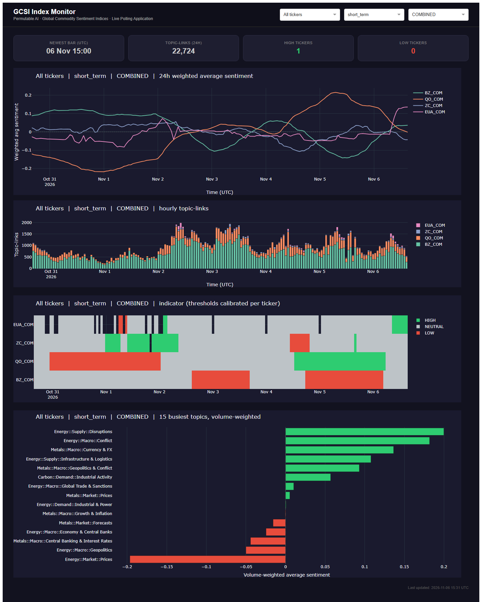
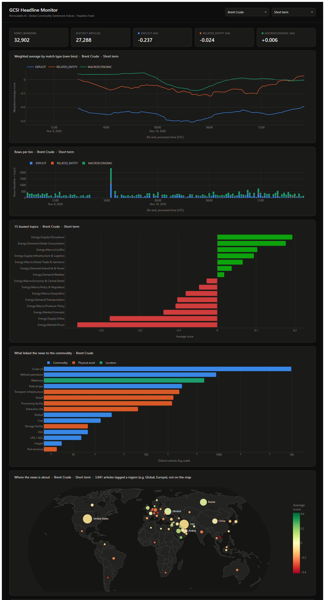

# Global Commodity Sentiment Indices (GCSI)

Examples and integration guides for **Permutable AI's Global Commodity Sentiment Indices (GCSI)**. GCSI covers headline sentiment for **84 commodities in six sectors** (Energy, Metals, Agriculture, Power, Freight and Carbon), with history from 2015.

> **Disclaimer:** All examples are provided for informational and research purposes only. Nothing here constitutes financial advice or a recommendation to buy, sell, or hold any asset. Sentiment scores are model outputs. They describe how news was judged at publication and are not forecasts of future prices.

---

## Contents

- [What GCSI measures](#what-gcsi-measures)
- [Data products](#data-products)
- [Reading the data correctly](#reading-the-data-correctly)
- [Examples in this folder](#examples-in-this-folder)
- [Quickstart](#quickstart)
- [Taxonomy reference](#taxonomy-reference)

---

## What GCSI measures

Each headline that mentions a commodity, or something linked to it, gets three scores from −1 to +1, one per **horizon**:

| `sentiment_type` | Part of the futures curve |
|---|---|
| `short_term` | The immediate reaction at the front of the curve |
| `medium_term` | The 3–6 month segment |
| `long_term` | The 12+ month segment |

**Sign convention:** positive means **bullish for the commodity price**, and negative means bearish. A supply disruption is therefore usually *positive* for the commodity it disrupts. Each score judges how the curve reprices when the headline is published. It is not a forecast, and the three horizons are not required to agree.

Each headline is also tagged with a **match type**, which says how it is linked to the commodity:

| Match / index type | What it contains |
|---|---|
| `EXPLICIT` | The commodity itself, plus its benchmarks, aliases and sub-types |
| `RELATED_ENTITY` | Other entities linked to the commodity in Permutable's knowledge graph, such as producers, infrastructure and policy instruments |
| `MACROECONOMIC` | Macro headlines from the Global Macro Sentiment Indices, kept only for the country and topic pairs configured as relevant to the commodity |
| `COMBINED` | Every row for that commodity, topic and hour, whatever its match type (index only). Equals the sum of the three match types. |

Each headline is classified into one or more **topics**, using a three-level hierarchy: sector, then L1 driver (Market, Macro, Supply, Demand, Corporate), then L2 topic. Example: `Energy::Supply::Outages & Disruptions`. See [Taxonomy reference](#taxonomy-reference).

---

## Data products

### Hourly index

One row per commodity × topic × index type × horizon × hour.

| Field | Type | Description |
|---|---|---|
| `ticker` | string | Commodity ticker, e.g. `BZ_COM` (Brent Crude) |
| `topic_name` | string | Topic label, `Sector::L1::L2` (see the taxonomy) |
| `topic_id` | string | Stable id for `topic_name` |
| `processed_at` | timestamp, UTC | **End** of the hourly window. The window is chosen from the time Permutable *processed* the headline and made it available. |
| `headline_count` | integer | Distinct articles in the window |
| `sentiment_sum` | float | Sum of this horizon's scores |
| `sentiment_abs_sum` | float | Sum of the absolute scores in the window |
| `sentiment_std` | float | **Sample** standard deviation of scores in the window; 0 when the window has fewer than two headlines |

`index_type` and `sentiment_type` are request parameters. They are not repeated on each row. The live route returns the last 24 hours as a plain list (at most 1000 rows, so call it once per ticker). The historical route is paginated, requires `start_date`, and covers at most 90 days.

### Headline feed

One row per headline × commodity × topic.

| Field | Description |
|---|---|
| `headline`, `link`, `source_name` | The article. Also `source_country`, `language` and `country` when present. |
| `ticker` | The commodity |
| `match_type` | `EXPLICIT`, `RELATED_ENTITY`, `MACROECONOMIC` or `COMBINED` |
| `matched_entity_types`, `matched_entities` | What in the headline linked it to the commodity |
| `topic`, `topic_probability` | Topic label (`Sector::L1::L2`) and the classifier's confidence (0–1) that the headline belongs to it. This is not a sentiment score. |
| `short_term_sentiment_score`, `medium_term_sentiment_score`, `long_term_sentiment_score` | The three horizon scores, from −1 to +1 |
| `processed_at` | UTC time Permutable processed the headline and made it available through the API |

The feed does not include a publisher publication time or a ticker name. The live route returns the last 24 hours as a plain list. The historical route is paginated, requires `start_date`, and covers at most 90 days.

Headline text, links and publisher names belong to their publishers. Use them in line with your Permutable licence, and do not republish them.

---

## Reading the data correctly

These are the points most often got wrong when people first use the data. Every notebook here follows them.

| Topic | Rule |
|---|---|
| **Timestamps** | Index `processed_at` is the *end* of the hour, binned by the time Permutable processed the headline and made it available. A bar stamped `10:00` covers headlines processed from 09:00 to 10:00 and is available at 10:00. |
| **Sparse output** | Hours with no headlines are omitted, not zero-filled. Reindex before computing rolling statistics on a regular clock. |
| **Revisions** | The most recent hourly bars can be revised as late headlines arrive. Re-poll and upsert. Never treat the newest hour as final. |
| **Index types** | Within a ticker, each headline gets one match type (priority `EXPLICIT`, then `RELATED_ENTITY`, then `MACROECONOMIC`), and `COMBINED` is their total. Use `COMBINED` for the full picture, or one of the three for a breakdown. Never add `COMBINED` to the others. |
| **Topics are multi-label** | One headline can sit in several topics. Summing `headline_count` across topics gives *topic-links*, not articles. The sum is still a valid topic-weighted average, but label it that way. |
| **Horizons** | Analyse one `sentiment_type` at a time. Never add horizons together. |
| **Average sentiment** | `sentiment_avg = sentiment_sum / headline_count`, in [−1, +1] |
| **Pooling `sentiment_std`** | Hourly standard deviations cannot be averaged. Rebuild the sum of squares as `(n − 1)·std² + n·mean²`, add those across hours, then recompute the standard deviation. See `pool` in [`notebooks/utils/metrics.py`](notebooks/utils/metrics.py). |
| **Score scale** | Calibrate thresholds from the data for each commodity and horizon, using percentiles or z-scores, rather than fixed values. |
| **Backfill timing** | Historical `processed_at` times were reconstructed for the backfill period. Treat point-in-time accuracy before the live period as approximate, and allow a lag in research. |
| **Backfilled scores** | History before the live period was scored after the fact by the current sentiment models, so research results on it are in-sample for those models. Only data processed live shows what you would have seen at the time. |

---

## Examples in this folder

```
global_commodity_sentiment/
├── README.md                        # This file
├── reference/
│   └── gcsi_topics.csv              # Sector / L1 / L2 topic hierarchy with descriptions
├── notebooks/
│   ├── utils/                       # Shared helpers: api, store (SQLite), metrics, charts
│   ├── getting_started/
│   │   ├── gcsi_quickstart.ipynb    # First call, first chart
│   │   └── gcsi_infrastructure_watchlist.ipynb  # Named refineries and pipelines → map, timeline, feed
│   ├── live/
│   │   ├── gcsi_index_polling.ipynb     # Hourly index → SQLite → indicator
│   │   └── gcsi_headline_polling.ipynb  # Headline feed → own aggregation
└── app/
    ├── live_index_polling/          # poller / api / dashboard (Docker)
    └── live_headline_polling/       # poller / api / dashboard (Docker)
```

| Notebook | Data source | What it shows |
|---|---|---|
| [`gcsi_quickstart`](notebooks/getting_started/gcsi_quickstart.ipynb) | API | Authenticate, pull a week of Brent, and plot all three horizons |
| [`gcsi_infrastructure_watchlist`](notebooks/getting_started/gcsi_infrastructure_watchlist.ipynb) | API | A custom feed for a watchlist of named oil refineries, pipelines and storage sites, filtered with `matched_entity_type_preset`: map, timeline and headline table |
| [`gcsi_index_polling`](notebooks/live/gcsi_index_polling.ipynb) | API | Live hourly index polling into SQLite, horizon and index-type breakdowns, and a calibrated HIGH / NEUTRAL / LOW indicator |
| [`gcsi_headline_polling`](notebooks/live/gcsi_headline_polling.ipynb) | API | Headline feed with match types, topic-probability filtering, the matched entities, countries and sources behind the news, and your own 15-minute aggregation |

The notebooks keep to configuration, analysis steps and explanation. The API client (retries and pagination), SQLite storage, metrics such as `pool` and `own_index`, and the chart code are in [`notebooks/utils`](notebooks/utils/), which every notebook imports.

The notebooks are saved with their outputs from a run against the live API. Those runs set `SHOW_HEADLINE_TEXT=0`, so saved tables leave out headline text, links and publishers. Run the notebooks yourself to see them.

The two apps use the same three-service architecture as the other products in this repository (`poller` / `api` / `dashboard`). See each app's README.

### Example dashboards

**[`app/live_index_polling`](app/live_index_polling/)** polls the hourly index for several commodities and shows the 24-hour weighted average, news volume, a calibrated HIGH / NEUTRAL / LOW indicator and the busiest topics.



**[`app/live_headline_polling`](app/live_headline_polling/)** polls the headline feed for one commodity and builds its own 15-minute index by match type, with news volume, the busiest topics, what linked the news to the commodity and a map of the countries it is about.



---

## Quickstart

```bash
git clone https://github.com/saffronblueai/permutable-examples.git
cd permutable-examples/systematic/global_commodity_sentiment

pip install jupyter requests pandas numpy scipy matplotlib seaborn plotly kaleido
export API_KEY=<your-permutable-api-key>   # or enter it when the notebook prompts
jupyter notebook notebooks/getting_started/gcsi_quickstart.ipynb
```

---

## Taxonomy reference

[`reference/gcsi_topics.csv`](reference/gcsi_topics.csv) lists every GCSI topic with its sector, L1 driver, L2 name and a short description.

| Sector | L1 drivers | L2 topics |
|---|---|---|
| Agriculture | Market, Macro, Supply, Demand, Corporate | 30 |
| Energy | Market, Macro, Supply, Demand, Corporate | 26 |
| Metals | Market, Macro, Supply, Demand, Corporate | 27 |
| Power | Market, Macro, Supply, Demand, Corporate | 24 |
| Freight | Market, Macro, Supply, Demand, Corporate | 19 |
| Carbon | Market, Macro, Supply, Demand | 16 |

Topic labels use `::`, for example `Energy::Supply::Outages & Disruptions`. `TOPIC_SEPARATOR` in the notebooks is `::`, and the notebooks convert other separators to it when they load a file. A commodity's topics come from its own sector.

Commodities are referred to by ticker code (for example `BZ_COM`). The ticker catalog is `GET /v1/headlines/topics/gcsi/tickers/presets`.

---

## API access

All examples need a **Permutable AI API key**. Set it as the `API_KEY` environment variable (apps), or enter it through `getpass` when prompted (notebooks). Every request sends it in the `x-api-key` header.

Routes:

| Method | Path | What it returns |
|---|---|---|
| `GET` | `/v1/headlines/index/gcsi/live` | Hourly index, last 24 hours, plain list |
| `GET` | `/v1/headlines/index/gcsi/historical` | Hourly index, paginated, up to 90 days |
| `GET` | `/v1/headlines/feed/live/gcsi` | Headlines, last 24 hours, plain list |
| `GET` | `/v1/headlines/feed/historical/gcsi` | Headlines, paginated, up to 90 days |
| `GET` | `/v1/headlines/topics/gcsi/tickers/presets` | Ticker catalog |
| `GET` | `/v1/headlines/topics/gcsi/topics/presets` | Topic catalog |
| `GET` | `/v1/headlines/topics/gcsi/entity_types/presets` | Entity-type catalog |

The ticker and topic are query presets (`ticker_preset`, `topic_preset`), not part of the path.

- Documentation: [docs.copilot-api.permutable.ai](https://docs.copilot-api.permutable.ai)
- Account and key management: [permutable.ai](https://permutable.ai)

Rate limits apply per key. Every request counts once against your monthly quota, however many rows it returns. On `429 Too Many Requests`, back off exponentially with jitter. All examples here do this.
