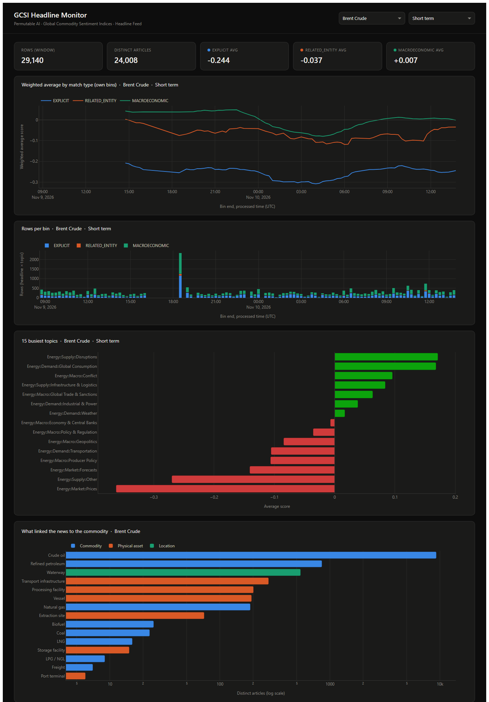
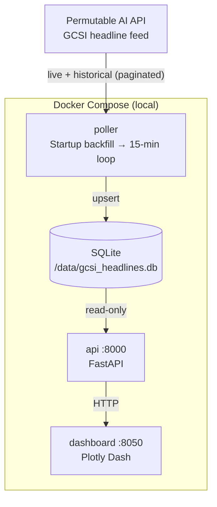

# GCSI Headline Feed Live Polling Application



An example Python application that continuously polls the [Permutable AI](https://permutable.ai) **Global Commodity Sentiment Indices (GCSI)** headline feed, stores each headline in a local database, builds its own short-interval index from them, and serves the results through a FastAPI service and a Plotly Dash dashboard.

> **This is a reference example, not a production template.** It shows the integration pattern and gives you a working starting point. Review, adapt and harden it before any real use, including storage, authentication, error handling and deployment.

It extends the workflow in the companion notebook [`notebooks/live/gcsi_headline_polling.ipynb`](../../notebooks/live/gcsi_headline_polling.ipynb).

> **Disclaimer:** This application is provided for informational and research purposes only. Nothing in it constitutes financial advice or a recommendation to buy, sell, or hold any asset. Sentiment scores are model outputs, not price forecasts. Headline text, links and publisher names belong to their publishers: use them under your Permutable licence and do not republish them.

---

## Architecture



### Headline feed vs hourly index

| | Headline feed (this app) | Hourly index (`live_index_polling`) |
|---|---|---|
| **Granularity** | One row per headline × commodity × topic | One row per commodity × topic × index type × horizon × hour |
| **Scores** | Three horizon scores on every row | One horizon per row (`sentiment_type`) |
| **Aggregation** | Yours: any interval, any filter | Pre-aggregated hourly |
| **Best for** | Custom windows, filters, headline drill-down | Monitoring, downstream integration |

---

## Quickstart

```bash
cd permutable-examples/systematic/global_commodity_sentiment/app/live_headline_polling
cp .env.example .env      # set API_KEY and TICKERS
docker compose up --build
```

**Dashboard:** [http://localhost:8050](http://localhost:8050) · **API docs:** [http://localhost:8000/docs](http://localhost:8000/docs)

---

## How the numbers are built

| Step | Rule |
|---|---|
| Storage key | The feed has no row id. Each row is keyed on (ticker, topic, match type, link or headline, processed time), so overlapping polls and re-runs never duplicate rows. |
| Bins | Built on **`processed_at`** (when Permutable received the headline) and labelled by their **end**, like the hourly index. The feed does not carry a publisher publication time. |
| Counts | One article can sit in several topics, so per-bin counts are rows (headline × topic). Within a ticker each headline has one match type, so articles add up across match types. |
| Smoothing | `Σ sentiment_sum / Σ headline_count` over the last `SMOOTHING_HOURS`. Readings with fewer than `MIN_HEADLINES` rows, or inside the first window, are left empty. |
| `sentiment_std` | Sample standard deviation per bin, 0 for a single headline (same convention as the index). |
| Topic filter | `MIN_TOPIC_PROBABILITY` drops less certain topic assignments. `topic_probability` measures topic confidence, not sentiment. |

---

## Configuration reference

| Variable | Default | Description |
|---|---|---|
| `API_KEY` | *(required)* | Your Permutable AI API key |
| `BASE_URL` | `https://copilot-api.permutable.ai/v1` | API base URL |
| `FEED_LIVE_PATH` / `FEED_HISTORICAL_PATH` | `/headlines/feed/live/gcsi`, `/headlines/feed/historical/gcsi` | GCSI headline routes |
| `TICKERS` | `BZ_COM` | Commodities to monitor |
| `MATCH_TYPES` | *(empty)* | Empty uses the API default `COMBINED`; or any of `EXPLICIT`, `RELATED_ENTITY`, `MACROECONOMIC` |
| `POLL_INTERVAL_SECONDS` | `900` | Seconds between live polls |
| `BACKFILL_DAYS` | `3` | History fetched on first start |
| `DB_PATH` | `/data/gcsi_headlines.db` | SQLite file inside the containers |
| `BIN_MINUTES` | `15` | Aggregation interval |
| `SMOOTHING_HOURS` | `6` | Window of the weighted rolling average |
| `MIN_HEADLINES` | `5` | Minimum rows in the window for a reading |
| `MIN_TOPIC_PROBABILITY` | `0.0` | Topic-confidence filter applied by the API service |
| `API_URL` | `http://api:8000` | Dashboard → API address |
| `REFRESH_INTERVAL_MS` | `60000` | Dashboard refresh interval |
| `DASHBOARD_HOURS` | `48` | Window shown on the dashboard |

---

## API endpoints

| Method | Path | Description |
|---|---|---|
| `GET` | `/health` | Status, row count and newest receipt time |
| `GET` | `/headlines` | Recent headlines; `ticker`, `match_type`, `hours`, `sort=recent|strongest`, `limit` |
| `GET` | `/sentiment/bins` | Own index: binned and smoothed per match type; `ticker`, `match_type`, `horizon`, `hours` |
| `GET` | `/topics` | Average score per topic, busiest first; `ticker`, `horizon`, `hours`, `limit` |
| `GET` | `/match-types` | Rows, distinct articles and average score per horizon for each match type |

```bash
curl "http://localhost:8000/match-types?ticker=BZ_COM"
curl "http://localhost:8000/sentiment/bins?ticker=BZ_COM&horizon=short_term&hours=48"
curl "http://localhost:8000/headlines?ticker=BZ_COM&sort=strongest&limit=10"
```

---

## Dashboard

- **Selectors:** commodity and horizon. Common tickers are shown by name; add more in `TICKER_NAMES` in `dashboard/config.py`
- **Stat cards:** rows, distinct articles, and the average score for each match type
- **Weighted average by match type**, from your own bins
- **Rows per bin**, stacked by match type
- **Topics:** the 15 busiest topics
- **Strongest headlines** of the last 6 hours, for drill-down

---

## Going further

Deployment patterns are the same as for the other apps in this repository: see [`headline_asset_sentiment/app/live_index_polling/README.md`](../../../headline_asset_sentiment/app/live_index_polling/README.md#going-further). The headline feed grows quickly, so for anything long-running move to PostgreSQL and prune old rows.

---

## Troubleshooting

**HTTP 403**: check `API_KEY`, and that your licence includes GCSI.

**HTTP 404**: check `FEED_LIVE_PATH` and `FEED_HISTORICAL_PATH` against [docs.copilot-api.permutable.ai](https://docs.copilot-api.permutable.ai).

**Smoothed line is empty**: there are fewer than `MIN_HEADLINES` rows in the window, or the dashboard window is shorter than `SMOOTHING_HOURS`.

---

## Licence

See the repository root for licence information.
