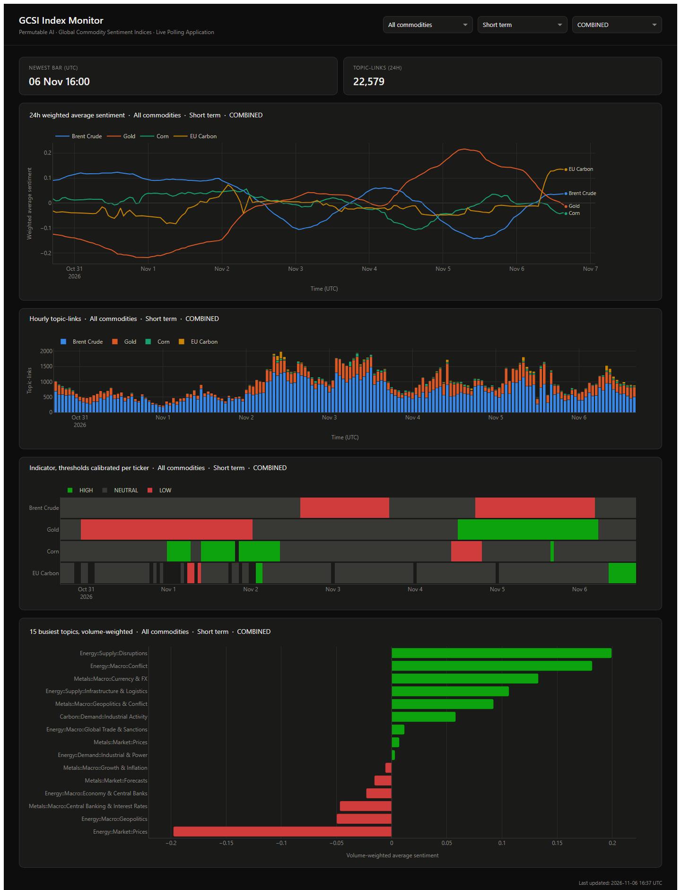
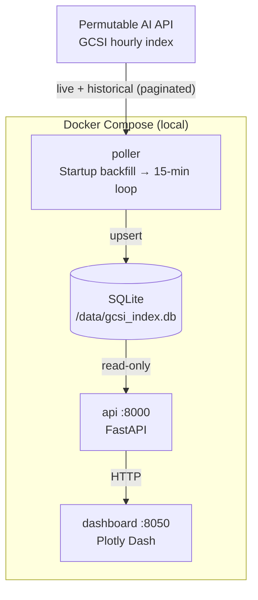

# GCSI Hourly Index Live Polling Application



An example Python application that continuously polls the [Permutable AI](https://permutable.ai) **Global Commodity Sentiment Indices (GCSI)** hourly index, stores it in a local database, and exposes it through a FastAPI service and a Plotly Dash monitoring dashboard.

> **This is a reference example, not a production template.** It shows the integration pattern and gives you a working starting point. Review, adapt and harden it before any real use, including storage, authentication, error handling and deployment.

It extends the workflow in the companion notebook [`notebooks/live/gcsi_index_polling.ipynb`](../../notebooks/live/gcsi_index_polling.ipynb).

> **Disclaimer:** This application is provided for informational and research purposes only. Nothing in it constitutes financial advice or a recommendation to buy, sell, or hold any asset. Sentiment data and indicators shown here are aggregated model outputs, not price forecasts, and should not be the sole basis for any investment decision.

---

## Architecture



| Service     | Role                                                                                    | Port |
|-------------|-----------------------------------------------------------------------------------------|------|
| `poller`    | Backfills history on startup, then polls live data every 15 min; the only writer        | —    |
| `api`       | FastAPI: index rows, smoothed sentiment with a calibrated indicator, topic summaries    | 8000 |
| `dashboard` | Plotly Dash: monitoring dashboard, refreshes every 60 s                                 | 8050 |

---

## Quickstart

```bash
git clone https://github.com/saffronblueai/permutable-examples.git
cd permutable-examples/systematic/global_commodity_sentiment/app/live_index_polling

cp .env.example .env
# Edit .env: set API_KEY and TICKERS (commodities included in your licence)

docker compose up --build
# The poller backfills BACKFILL_DAYS of history before the live loop starts.
```

**Dashboard:** [http://localhost:8050](http://localhost:8050) · **API docs:** [http://localhost:8000/docs](http://localhost:8000/docs)

---

## How the numbers are built

| Step | Rule |
|---|---|
| Series | One series per **ticker × `sentiment_type` × `index_type`**. Horizons and index types are never added together. |
| Hourly value | Topic rows are added per hour. Topics are multi-label, so the count is **topic-links** and the average is topic-weighted. |
| Smoothing | `sentiment_smooth = Σ sentiment_sum / Σ headline_count` over the last `SMOOTHING_HOURS` (time-based, so hours with no news are handled correctly). Readings with fewer than `MIN_HEADLINES` topic-links, or inside the first window, are left empty. |
| Indicator | `HIGH` / `LOW` when `sentiment_smooth` crosses that series' own thresholds. By default these are the 90th and 10th percentiles over `CALIBRATION_HOURS` (`THRESHOLD_MODE=percentile`), so each commodity is judged against its own history. |
| Topics | Volume-weighted average per topic: `Σ sentiment_sum / Σ headline_count` over the window. |
| Revisions | The newest bars can be revised. Every poll upserts, and a restart re-fetches `REVISION_HOURS` behind the newest stored bar. |

`processed_at` is the **end** of each hour (UTC), binned on when Permutable processed the headlines and made them available. The index response does not include `index_type` or `sentiment_type`; the poller writes both from the request.

---

## Configuration reference

All configuration comes from `.env`, which every service reads.

| Variable | Default | Description |
|---|---|---|
| `API_KEY` | *(required)* | Your Permutable AI API key |
| `BASE_URL` | `https://copilot-api.permutable.ai/v1` | API base URL |
| `INDEX_LIVE_PATH` / `INDEX_HISTORICAL_PATH` | `/headlines/index/gcsi/live`, `/headlines/index/gcsi/historical` | GCSI index routes |
| `TICKERS` | `BZ_COM,QO_COM,ZC_COM,EUA_COM` | Commodities to monitor |
| `INDEX_TYPES` | `COMBINED` | Any of `COMBINED`, `EXPLICIT`, `RELATED_ENTITY`, `MACROECONOMIC` |
| `SENTIMENT_TYPES` | `short_term,medium_term,long_term` | Horizons to poll. Each call uses `topic_preset=ALL`. |
| `POLL_INTERVAL_SECONDS` | `900` | Seconds between live polls |
| `BACKFILL_DAYS` | `30` | History fetched on first start |
| `REVISION_HOURS` | `6` | Overlap re-fetched on restart to pick up revised bars |
| `DB_PATH` | `/data/gcsi_index.db` | SQLite file inside the containers |
| `SMOOTHING_HOURS` | `24` | Window of the weighted rolling average |
| `MIN_HEADLINES` | `5` | Minimum topic-links in the window for a reading |
| `THRESHOLD_MODE` | `percentile` | `percentile` or `fixed` |
| `UPPER_PERCENTILE` / `LOWER_PERCENTILE` | `0.90` / `0.10` | Percentile thresholds |
| `UPPER_THRESHOLD` / `LOWER_THRESHOLD` | `0.15` / `-0.15` | Fixed thresholds |
| `CALIBRATION_HOURS` | `720` | History used for percentile thresholds |
| `API_URL` | `http://api:8000` | Dashboard → API address |
| `REFRESH_INTERVAL_MS` | `60000` | Dashboard refresh interval |
| `DASHBOARD_HOURS` | `168` | Window shown on the dashboard |

**Quota:** each poll cycle makes `tickers × index types × sentiment types` requests. The default is 12 requests every 15 minutes, about 35,000 a month. Every request counts against your monthly quota. One ticker over 24 hours fits in the live 1000-row cap. Do not poll `ticker_preset=ALL`: that response can be cut off.

---

## API endpoints

| Method | Path | Description |
|---|---|---|
| `GET` | `/health` | Status, row count and newest stored bar |
| `GET` | `/index` | Raw hourly rows; filters `ticker`, `sentiment_type`, `index_type`, `hours`, `limit` |
| `GET` | `/sentiment/latest` | Latest smoothed value and indicator per ticker; `sentiment_type`, `index_type` |
| `GET` | `/sentiment/history` | Smoothed series with thresholds and indicator; `ticker`, `sentiment_type`, `index_type`, `hours` |
| `GET` | `/topics` | Volume-weighted average per topic, busiest first; `ticker`, `sentiment_type`, `index_type`, `hours`, `limit` |

```bash
curl http://localhost:8000/health
curl "http://localhost:8000/sentiment/latest?sentiment_type=short_term"
curl "http://localhost:8000/sentiment/history?ticker=BZ_COM&sentiment_type=medium_term&hours=168"
curl "http://localhost:8000/topics?ticker=BZ_COM&hours=48"
```

---

## Dashboard

- **Selectors:** commodity (or all), horizon, and index type. Common tickers are shown by name; add more in `TICKER_NAMES` in `dashboard/config.py`
- **Stat cards:** newest bar and topic-links in the last 24 hours
- **24h weighted average sentiment** per ticker, with the calibrated HIGH / LOW lines when one ticker is selected
- **Hourly topic-links:** news volume
- **Indicator heatmap:** HIGH / NEUTRAL / LOW per ticker and hour
- **Horizons compared** (single ticker): short-, medium- and long-term on one chart
- **Topics:** the 15 busiest topics, volume-weighted

---

## Going further

Deployment patterns (a single VM, ECS/Fargate, Kubernetes CronJob, Airflow, PostgreSQL instead of SQLite) are the same as for the other apps in this repository. See [`headline_asset_sentiment/app/live_index_polling/README.md`](../../../headline_asset_sentiment/app/live_index_polling/README.md#going-further). For PostgreSQL, the upsert key here is `(ticker, topic_name, index_type, sentiment_type, processed_at)`.

---

## Troubleshooting

**Dashboard shows "waiting for poller…"**: the backfill runs before the live loop. Wait for `Backfill complete.` in `docker compose logs poller`.

**HTTP 403**: check `API_KEY`, and that your licence includes GCSI. New keys can take a few minutes to become active.

**HTTP 404**: check `INDEX_LIVE_PATH` and `INDEX_HISTORICAL_PATH` against [docs.copilot-api.permutable.ai](https://docs.copilot-api.permutable.ai).

**HTTP 422**: a ticker, index type or horizon value is not valid for your licence.

**Indicator is always NEUTRAL**: with `THRESHOLD_MODE=fixed`, the thresholds may be wider than the data. Switch to `percentile`, or narrow them.

---

## Licence

See the repository root for licence information.
