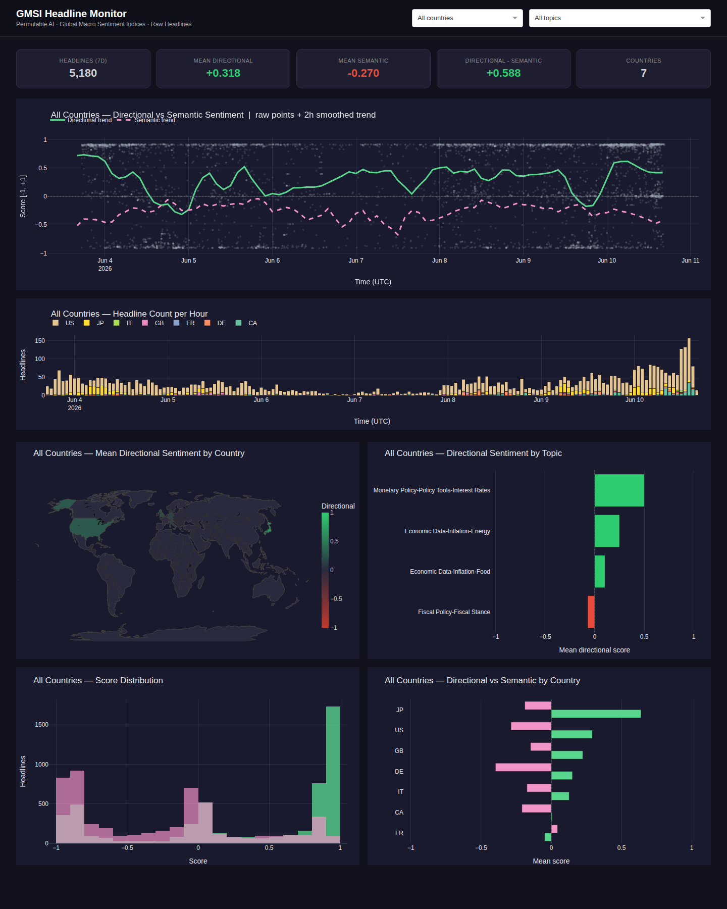

# GMSI Headline Live Polling Application



An example application that continuously polls the [Permutable AI](https://permutable.ai) **Global Macro Sentiment Indices (GMSI) raw headline feed**, stores results in a local SQLite database, and exposes the data through a FastAPI service and a Plotly Dash monitoring dashboard.

> **This is a reference example, not a production template.** It is intended to illustrate the integration pattern and give you a working starting point. Review, adapt, and harden it before using it in any real environment.

> **Disclaimer:** This application is provided for informational and research purposes only. Nothing here constitutes financial advice or a recommendation to buy, sell, or hold any asset.

This application demonstrates an extended version of the workflow in the companion notebook:
[`notebooks/live/gmsi_headline_polling.ipynb`](../../notebooks/live/gmsi_headline_polling.ipynb)

---

## About GMSI Headlines

Each record in the GMSI headline feed represents a single news headline attributed to a **country** and classified into a **macro topic**. Every headline is scored by two independent models:

- **Directional score** (`directional_score`): topic-specific, e.g. +1 = inflation rising, −1 = inflation falling.
- **Semantic sentiment score** (`semantic_sentiment_score`): general language tone, e.g. +1 = upbeat/optimistic, −1 = alarming/pessimistic.

The two scores often diverge — surging inflation reported in alarming language is directionally positive (+) but semantically negative (−).

---

## Architecture

```
                          Docker Compose
┌──────────────────────────────────────────────────────────────────────┐
│  poller                api  :8000              dashboard  :8050      │
│  ─────────────         ────────────            ───────────────────   │
│  backfill on start  →  FastAPI read-only   →   Plotly Dash           │
│  15-min live loop      /headlines              directional vs        │
│  (country × topic)     /signals/latest         semantic charts       │
│       │                /signals/history                              │
│       ▼                                                              │
│  SQLite  /data/gmsi_headlines.db                                     │
└──────────────────────────────────────────────────────────────────────┘
         ▲
  Permutable AI API
  /v1/headlines/feed/live/gmsi/{country}
  /v1/headlines/feed/historical/gmsi/{country}
```

| Service | Port | Role |
|---|---|---|
| `poller` | — | Backfills history on startup, then polls every 15 min for all configured country/topic combinations |
| `api` | 8000 | FastAPI — read-only access to the database |
| `dashboard` | 8050 | Plotly Dash — auto-refreshes every 60 s |

---

## Quickstart

```bash
# 1. Navigate to the app directory
cd permutable-examples/systematic/global_macro_sentiment/app/live_headline_polling

# 2. Create and edit your .env file
cp .env.example .env
# Set API_KEY, and optionally adjust COUNTRIES and TOPICS

# 3. Build and start all services
docker compose up --build
```

- **Dashboard:** [http://localhost:8050](http://localhost:8050)
- **API docs:** [http://localhost:8000/docs](http://localhost:8000/docs)

The poller runs a historical backfill before entering the live loop. Wait for `Backfill complete.` in the logs before expecting dashboard data.

To run in the background:

```bash
docker compose up --build -d
docker compose logs -f
```

To stop:

```bash
docker compose down       # stop containers
docker compose down -v    # also remove the database volume
```

---

## Configuration

All settings are read from `.env`. Every service reads from the same file.

| Variable | Default | Description |
|---|---|---|
| `API_KEY` | *(required)* | Your Permutable AI API key |
| `COUNTRIES` | `US,JP,IT,GB,FR,DE,CA` | Comma-separated ISO-2 country codes (see `GET /v1/countries`) |
| `TOPICS` | `Monetary Policy-Policy Tools-Interest Rates,Economic Data-Inflation-Energy,Economic Data-Inflation-Food,Fiscal Policy-Fiscal Stance` | Comma-separated full GMSI topic names (see `GET /v1/headlines/topics/gmsi`) |
| `MATCH_TYPE` | `COMBINED` | Coverage lens: `DOMESTIC`, `INTERNATIONAL`, or `COMBINED` |
| `POLL_INTERVAL_SECONDS` | `900` | Seconds between live polls (default 15 min) |
| `BACKFILL_DAYS` | `7` | Days of history to seed on startup |
| `DB_PATH` | `/data/gmsi_headlines.db` | SQLite file path inside containers |
| `UPPER_THRESHOLD` | `0.1` | Directional score threshold for HIGH signal |
| `LOWER_THRESHOLD` | `-0.1` | Directional score threshold for LOW signal |
| `API_URL` | `http://api:8000` | Dashboard → API address |
| `REFRESH_INTERVAL_MS` | `60000` | Dashboard auto-refresh in milliseconds |

> **Adding more countries or topics:** Update `COUNTRIES` and `TOPICS` in `.env` and restart. The poller backfills the new combinations on the next startup.

---

## API Endpoints

| Method | Path | Description |
|---|---|---|
| `GET` | `/health` | Service status and row count |
| `GET` | `/headlines` | Raw headlines; params: `country`, `topic`, `hours` (default 24), `limit` (default 5 000) |
| `GET` | `/signals/latest` | Latest signal per (country, topic) |
| `GET` | `/signals/history` | Full 15-min signal history; params: `country`, `topic`, `hours` |

```bash
# Health check
curl http://localhost:8000/health

# Recent headlines for the US
curl "http://localhost:8000/headlines?country=US&hours=6&limit=500"

# Latest signals for all countries/topics
curl http://localhost:8000/signals/latest
```

---

## Dashboard

The dashboard auto-refreshes every minute. Filters at the top apply to all charts simultaneously.

**Charts displayed:**

- **Stat cards** — 7-day headline count, mean directional score, mean semantic score, divergence, and active countries
- **Score time series** — raw headline scores with smoothed directional and semantic trends
- **Hourly headline count** — stacked bar showing news flow volume by country
- **World map** — mean directional score by country
- **Topic and country bars** — directional sentiment by topic and directional-vs-semantic comparison by country
- **Score distribution** — directional and semantic score histograms

---

## Score Semantics

| Score | Meaning | Range |
|---|---|---|
| `directional_score` | Topic-specific direction (e.g. +1 = inflation rising) | [−1, +1] |
| `semantic_sentiment_score` | General language tone (+1 = upbeat, −1 = alarming) | [−1, +1] |

The **divergence** between the two scores is often the most interesting signal. A country reporting strongly rising inflation (`directional` +) in alarming language (`semantic` −) is a different risk environment from one where inflation rises and the tone is calm.

---

## Related Resources

- [`notebooks/live/gmsi_headline_polling.ipynb`](../../notebooks/live/gmsi_headline_polling.ipynb) — companion notebook covering the same polling workflow
- [`app/live_index_polling/`](../live_index_polling/) — hourly pre-aggregated GMSI index application
- [Permutable AI API Documentation](https://docs.permutable.ai)
