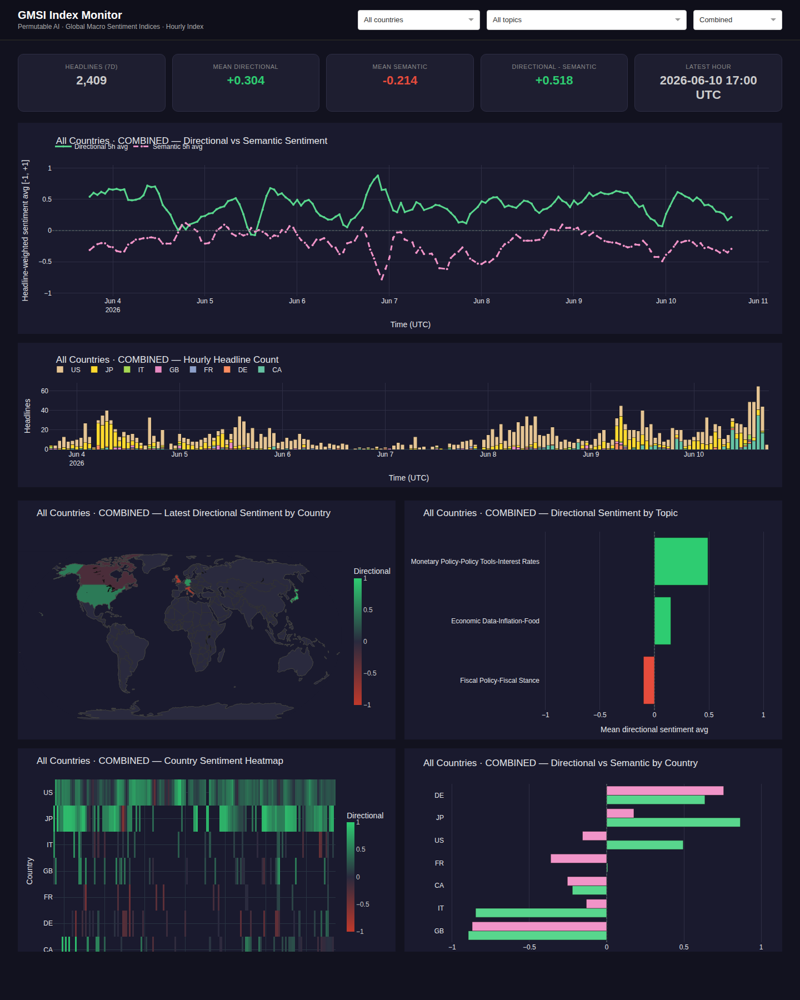

# GMSI Hourly Index Live Polling Application



An example application that continuously polls the [Permutable AI](https://permutable.ai) **Global Macro Sentiment Indices (GMSI) Hourly Index API**, stores results in a local SQLite database, and exposes the data through a FastAPI service and a Plotly Dash monitoring dashboard.

> **This is a reference example, not a production template.** It is intended to illustrate the integration pattern and give you a working starting point. Review, adapt, and harden it before using it in any real environment.

> **Disclaimer:** This application is provided for informational and research purposes only. Nothing here constitutes financial advice or a recommendation to buy, sell, or hold any asset.

This application demonstrates an extended version of the workflow in the companion notebook:
[`notebooks/live/gmsi_index_polling.ipynb`](../../notebooks/live/gmsi_index_polling.ipynb)

---

## About GMSI Hourly Index

The GMSI Hourly Index aggregates raw GMSI headlines into one-hour windows, keyed by **country**, **topic**, **sentiment type**, and **index type**. Each hourly bucket contains:

| Field | Description |
|---|---|
| `headline_count` | Headlines contributing to the window |
| `sentiment_sum` | Sum of scores across contributing headlines |
| `sentiment_abs_sum` | Sum of absolute scores — total signal magnitude |
| `sentiment_std` | Standard deviation — disagreement or controversy |

Two **sentiment types** are stored separately, enabling direct comparison:

| Sentiment type | Meaning |
|---|---|
| `directional` | Topic-specific direction (e.g. +1 = inflation rising) |
| `semantic_sentiment` | General language tone (+1 = upbeat, −1 = alarming) |

Derived metrics:

```python
sentiment_avg     = sentiment_sum / headline_count        # mean per-headline, ∈ [−1, +1]
activity_weighted = sentiment_sum / sentiment_abs_sum     # volume-adjusted direction
```

---

## Architecture

```
                          Docker Compose
┌──────────────────────────────────────────────────────────────────────┐
│  poller                api  :8000              dashboard  :8050      │
│  ─────────────         ────────────            ───────────────────   │
│  backfill on start  →  FastAPI read-only   →   Plotly Dash           │
│  15-min live loop      /gmsi                   directional +         │
│  (country × topic ×    /sentiment/latest       semantic charts       │
│   index_type ×         /sentiment/history      world maps            │
│   sentiment_type)                                                    │
│       │                                                              │
│       ▼                                                              │
│  SQLite  /data/gmsi_index.db                                         │
└──────────────────────────────────────────────────────────────────────┘
         ▲
  Permutable AI API
  /v1/headlines/index/gmsi/live/{country}
  /v1/headlines/index/gmsi/historical/{country}
```

| Service | Port | Role |
|---|---|---|
| `poller` | — | Backfills history on startup, then polls every 15 min for all configured combinations |
| `api` | 8000 | FastAPI — read-only access to the database |
| `dashboard` | 8050 | Plotly Dash — auto-refreshes every 60 s |

---

## Quickstart

```bash
# 1. Navigate to the app directory
cd permutable-examples/systematic/global_macro_sentiment/app/live_index_polling

# 2. Create and edit your .env file
cp .env.example .env
# Set API_KEY, and optionally adjust COUNTRIES and TOPICS

# 3. Build and start all services
docker compose up --build
```

- **Dashboard:** [http://localhost:8050](http://localhost:8050)
- **API docs:** [http://localhost:8000/docs](http://localhost:8000/docs)

The poller runs a historical backfill before entering the live loop. Wait for `Backfill complete.` in the logs before expecting dashboard data.

---

## Configuration

All settings are read from `.env`. Every service reads from the same file.

| Variable | Default | Description |
|---|---|---|
| `API_KEY` | *(required)* | Your Permutable AI API key |
| `COUNTRIES` | `US,JP,IT,GB,FR,DE,CA` | Comma-separated ISO-2 country codes |
| `TOPICS` | `Monetary Policy-Policy Tools-Interest Rates,Economic Data-Inflation-Energy,Economic Data-Inflation-Food,Fiscal Policy-Fiscal Stance` | Comma-separated full GMSI topic names |
| `INDEX_TYPES` | `COMBINED` | Comma-separated coverage lenses: `DOMESTIC`, `INTERNATIONAL`, `COMBINED` |
| `SENTIMENT_TYPES` | `directional,semantic_sentiment` | Comma-separated scoring models |
| `SPARSE` | `true` | Return only hourly buckets that contain headlines |
| `ALIGN_TO_PERIOD_END` | `true` | Timestamp each bucket at the close of the hour |
| `POLL_INTERVAL_SECONDS` | `900` | Seconds between live polls (default 15 min) |
| `BACKFILL_DAYS` | `7` | Days of history to seed on startup |
| `DB_PATH` | `/data/gmsi_index.db` | SQLite file path inside containers |
| `UPPER_THRESHOLD` | `0.5` | `sentiment_avg` threshold for HIGH indicator |
| `LOWER_THRESHOLD` | `-0.5` | `sentiment_avg` threshold for LOW indicator |
| `API_URL` | `http://api:8000` | Dashboard → API address |
| `REFRESH_INTERVAL_MS` | `60000` | Dashboard auto-refresh in milliseconds |

> **Adding more countries, topics, or index types:** Update the corresponding env vars and restart. The poller backfills the new combinations on the next startup.

> **Managing request quota:** Each combination of (country, topic, sentiment_type, index_type) makes one API call per poll cycle. The screenshot defaults use seven countries x four topics x two sentiment types x one index type = 56 calls per cycle at the default 15-minute interval. Reduce `COUNTRIES` or `TOPICS` for a lighter setup.

---

## API Endpoints

| Method | Path | Description |
|---|---|---|
| `GET` | `/health` | Service status and row count |
| `GET` | `/gmsi` | Raw index records; params: `country`, `topic`, `sentiment_type`, `index_type`, `hours`, `limit` |
| `GET` | `/sentiment/latest` | Latest indicator per (country, topic, sentiment_type, index_type) |
| `GET` | `/sentiment/history` | Full hourly series; params: `country`, `topic`, `sentiment_type`, `index_type`, `hours` |

```bash
# Health check
curl http://localhost:8000/health

# Directional index for the US over 7 days
curl "http://localhost:8000/gmsi?country=US&sentiment_type=directional&hours=168"

# Latest directional indicators for all countries
curl "http://localhost:8000/sentiment/latest?sentiment_type=directional&index_type=COMBINED"

# 7-day sentiment history for GB, directional
curl "http://localhost:8000/sentiment/history?country=GB&sentiment_type=directional&hours=168"
```

---

## Dashboard

The dashboard auto-refreshes every minute. The country, topic, and index type dropdowns at the top filter all charts simultaneously.

**Charts displayed:**

- **Stat cards** — 7-day headline count, mean directional avg, mean semantic avg, divergence, and latest hour
- **Sentiment time series** — headline-weighted directional and semantic rolling averages
- **Hourly headline count** — stacked bar showing news flow volume by country
- **World map** — latest directional sentiment by country
- **Topic and country bars** — directional sentiment by topic and directional-vs-semantic comparison by country
- **Country heatmap** — rolling directional sentiment by country and hour

---

## Sentiment Signal Derivation

```
sentiment_avg     = sentiment_sum / headline_count     ∈ [−1, +1]
activity_weighted = sentiment_sum / sentiment_abs_sum  ∈ [−1, +1]
sentiment_smooth  = rolling_mean(sentiment_avg, 5h)

HIGH:    sentiment_smooth >  UPPER_THRESHOLD (+0.5)
LOW:     sentiment_smooth <  LOWER_THRESHOLD (−0.5)
NEUTRAL: otherwise
```

The `activity_weighted` metric accounts for volume — a period with 100 strong-conviction headlines in one direction reads differently from one where the same `sentiment_sum` is spread across many weak signals.

---

## Related Resources

- [`notebooks/live/gmsi_index_polling.ipynb`](../../notebooks/live/gmsi_index_polling.ipynb) — companion notebook
- [`app/live_headline_polling/`](../live_headline_polling/) — raw GMSI headline application
- [Permutable AI API Documentation](https://docs.permutable.ai)
